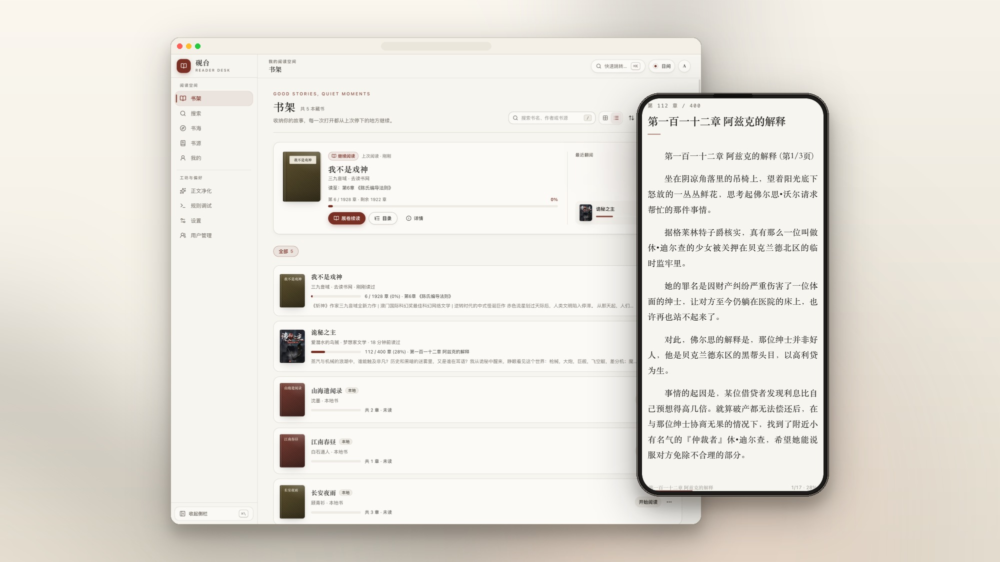

<div align="center">

# 砚台 · Reader

**自托管在线阅读服务 —— 多源流式搜索 · 书海发现 · 沉浸阅读器 · 书源工坊 · 正文净化 · 听书朗读**

Rust (`axum` + `SQLite`) + React 19 (`frontend-v2` + Tailwind CSS v4) · 单容器部署 · 数据完全掌握在自己手中

[](https://github.com/hehecat/reader/actions/workflows/ci.yml)

[快速开始](#快速开始) · [界面展示](#界面展示) · [核心特性](#核心特性) · [架构与目录](#架构与目录) · [配置说明](#配置说明) · [本地开发](#本地开发)

</div>



书源在你手里，书架在你手里，阅读进度与笔记也在你手里。

**砚台（Reader）** 将 legado 书源生态与现代纸面阅读体验融进一个轻量的 Rust 单容器：多源并发流式搜书、书海频道探索与后台探活、多端沉浸式阅读器、规则调试工作台、正文正则净化、整书离线缓存、WebDAV 云备份与 TTS 朗读，全部运行在自己的设备上，不依赖第三方云账号。

---

## 快速开始

### Docker Compose（推荐）

```bash
git clone https://github.com/hehecat/reader.git
cd reader/deploy
docker compose up -d
```

打开 `http://<机器IP>:8080` 即可使用（默认单用户本地模式，无需 `.env`）：

1. **导入书源**：进入「书源」→「导入书源」，粘贴 legado 书源 JSON、拖入本地文件或填写远程订阅地址（仓库不内置任何书源）。
2. **搜书与书海**：在「搜索」页流式聚合多源结果，或在「书海」页浏览各书源榜单与分类。
3. **试读与收藏**：点开任意作品可直接试读或切源预览，满意后再「收入书房」。

### 单行 Docker 运行

```bash
docker run -d --name reader -p 8080:8080 \
  -v "$PWD/data:/storage/storage" \
  -e READER_APP_WORKDIR=/storage \
  ghcr.io/hehecat/reader:latest
```

### 开启多用户安全模式

```bash
cd deploy
cp .env.example .env
# 在 .env 中设置：
# READER_APP_MODE=multi
# READER_APP_SECURE=true
# READER_APP_INVITECODE=<你的邀请码>
docker compose up -d
```

---

## 界面展示

### 桌面端 · 书房书架与宣纸沉浸阅读


### 移动端 · 无框细线书架、沉浸阅读与书海发现


---

## 核心特性

### 纸面沉浸阅读体验（桌面端 + 移动端）
- **四套纸色主题**：日间宣纸、羊皮纸、护眼绿、夜间墨色，全站视觉与阅读纸面统一调色。
- **跨端定制排版**：
  - **桌面端**：天头地脚状态栏（含时间与进度）、居中悬浮底栏、宽屏自动双页对开、仿真翻页 / 无动画切换、全键盘快捷键操作。
  - **移动端**：高屏占比纯底栏阅读态、贴边全宽控制栏、等高平滑切换的目录/全书搜索抽屉；全站移动端统一采用**无框细线 + 底线页签**的沉浸式纸面设计语言，拒绝卡片与胶囊堆叠。
- **书签、划线与笔记**：支持多色划线批注、书签定位与全书正文检索。
- **听书朗读（TTS）**：支持 Edge TTS、自定义 HttpTTS 音源以及浏览器内置语音兜底。

### 多源引擎与书海发现
- **多源 SSE 流式搜索**：三层健康置信度排序（已验证好源优先、待测源次之、失效源后置），实时聚合同名作品、随时可停或加载下一批。
- **书海频道与后台探活**：支持网格 / 列表（含书籍简介）双视图切换；后台并发探活自动置顶有书频道并过滤空源，切页不中断。
- **智能换源**：已入架书籍后端换源并保留阅读进度；未入架书籍支持直接切源试读；支持按默认 / 最新 / 最快排序。
- **完整 legado 规则引擎**：CSS Selector / JSONPath / XPath / 正则 / Boa JS 沙箱，支持 `@put/@get` 书级变量与登录 Cookie 管理。

### 书源工坊与个人书房
- **书源管理与规则调试台**：批量启停/测速/导入导出、双栏结构化规则编辑 + 原始 JSON + 实时 SSE 解析追踪。
- **正文净化沙箱**：编写正则替换规则并实时预览去广告/水印效果（支持单规则与全链模式）。
- **本地书与多级缓存**：支持 `.txt` / `.epub` 导入、目录监听自动同步与自定义分章规则；支持整书后台离线缓存与分级缓存清理。
- **多用户与备份**：命名空间数据隔离、用户配额与权限管理、WebDAV 云端备份与一键恢复、SQLite WAL 高并发连接池。

---

## 架构与目录

| 目录 | 说明 |
| --- | --- |
| `backend/` | Rust 后端（`axum` + `sqlx/SQLite` + `boa_engine` + `reqwest`），模块化拆分为 `api/`、`storage/`、`parser/`、`service/` |
| `frontend-v2/` | 全新重构前端（React 19 + TypeScript + Vite 7 + Tailwind CSS v4 + Framer Motion + TanStack Query） |
| `deploy/` | Docker Compose 配置与 `.env.example` 模板 |
| `docs/` | 详细配置与运维文档 |

---

## 配置说明

常用环境变量（完整配置与反向代理说明见 [docs/configuration.md](docs/configuration.md)）：

| 变量 | 默认值 | 说明 |
| --- | --- | --- |
| `READER_SERVER_PORT` | `8080` | 服务端监听端口（Compose 用 `READER_PORT` 映射宿主机端口） |
| `READER_APP_WORKDIR` | `.` | 数据根目录，SQLite 数据库与封面/缓存位于其 `storage/` 下 |
| `READER_APP_MODE` | `single` | 运行模式：`single`（单用户）或 `multi`（多用户） |
| `READER_APP_SECURE` | `false` | 是否启用登录鉴权与会话保护 |
| `READER_APP_INVITECODE` | — | 多用户模式下新用户注册邀请码 |
| `READER_DB_MAX_CONNECTIONS` | `24` | SQLite WAL 连接池上限（范围 `1..64`） |
| `READER_LOG_DIR` | — | 可选，开启按日轮转的后端日志文件目录 |
| `READER_APP_WEB_ROOT` | — | 可选，指定外部前端静态资源目录（覆盖内置 `rust-embed` 产物） |

---

## 本地开发

环境要求：Rust 1.90+、Node.js 22+、`pnpm` 11+。

```bash
# 1. 构建前端并同步到后端嵌入目录
cd frontend-v2
pnpm install
pnpm typecheck && pnpm lint && pnpm build
rm -rf ../backend/web-ui/dist && cp -R dist ../backend/web-ui/dist

# 2. 运行后端测试与服务
cd ../backend
cargo test --lib --tests
READER_SERVER_PORT=4605 READER_APP_WEB_ROOT="$PWD/web-ui/dist" cargo run --bin reader-dev
```

更多开发规范与测试命令见 [AGENTS.md](AGENTS.md)，运维与排错见 [docs/operations.md](docs/operations.md)。

---

## 致谢

- [legado](https://github.com/gedoor/legado)：书源规则语义与生态
- [reader (warpdotsys)](https://github.com/warpdotsys/reader-dev)：Rust 重写路线参考
- [hectorqin/reader](https://github.com/hectorqin/reader)：早期服务器版起点
